<p align="center">
  
</p>

<p align="center">
  
  &nbsp;<strong>A team of AI agents in your terminal, assembled for whatever you're trying to do.</strong>
</p>

<p align="center">
  
  
  
  
</p>

---

You tell **Captain** what you want to get done. Captain picks a squad that fits: a researcher, a budget
analyst, an architect, a skeptic, whoever the job actually needs. The squad works **in parallel**. When a
real decision comes up, Captain calls everyone into a **war room** with you. Before anything reaches you, a
reviewer checks it.

```bash
npx brainiverse install
```
Open Claude Code, type `/brainiverse`, and describe your mission.

---

## Why we built this

A single AI assistant is a brilliant generalist working alone. Ask it to plan a trip, launch an app or
pressure-test a business idea, and it does the research, the maths, the building and the fact-checking
in one stream of thought. There's nobody to disagree with it and nobody to check its work.

Human teams don't work that way. Good ones split the work, argue about it, and have someone check it before
it goes out. We wanted that structure for everyday problems, without the usual multi-agent compromises:

- **No fake teams.** Many "multi-agent" demos are one model playing every role in a single prompt. In
  Brainiverse each agent is a real, separate Claude Code subagent with its own brief, tools and output.
- **No single-purpose rigs.** Most agent setups are hard-wired for one job, usually coding. Here the same
  machinery runs a travel plan, a codebase or a market study. Only the team changes.
- **No confident fiction.** Agents aren't allowed to claim they did something they didn't. Results are
  labelled *verified*, *proposed* or *assumed*, and the runtime keeps the receipts.
- **No loss of control.** Spending money, sending messages, deleting data, pushing code and installing
  anything all need your explicit OK, each time.

The result: the right minds for every mission, with you still in charge.

## What it feels like

```text
You      /brainiverse plan two weeks in Japan in April. I love food and temples.

Captain  Love it. A few questions first so we're on the same page:
           • Budget?            ○ Backpacker  ● Mid-range  ○ Comfort  ○ Luxury
           • Getting around?    ☐ Own car  ☑ Trains  ☑ Planes  ☐ Buses
           • Who's travelling?  ○ Solo  ● Couple  ○ Family  ○ Friends
           • Pace?              ● Relaxed  ○ Balanced  ○ Packed
         …and two more short rounds (where you like to stay, booking, the deadline).

Captain  Here's what I understood: 14 days in April, mid-range, trains and planes, a couple, relaxed pace,
         food and temples, a plan with booking links. And here's the squad I'd put on it:
           🛡️ Captain (Leader)              your point of contact
           🔭 Shirin (Researcher)           regions, cherry-blossom timing, advisories
           📊 Babak (Budget Analyst)       real costs per option
           🗺️ Olivia (Itinerary Planner)    the day-by-day plan
           🚆 Ryan (Logistics Expert)      rail passes, transfers, entry rules
           🎯 Parisa (Quality Reviewer)    checks facts and the budget before you see anything
         OK to start?

You      Go. Rename Shirin to Sherlock.

Captain  Done. Sherlock and Babak are working in parallel now…
         ⚔️ War Room: two good routes. Sherlock, Babak, you're up.
Sherlock (Researcher)      Kyoto-heavy gives you the temples and the best blossom odds (sources attached).
Babak (Budget Analyst)    It's also €340 cheaper if you skip one bullet-train leg.
Captain  Kyoto-heavy or Tokyo-heavy?

You      Kyoto. Babak, can we afford one ryokan night?

Babak (Budget Analyst)    Yes: one night fits if we drop the second Shinkansen leg. Want me to price three options?
```

Every line from Sherlock and Babak above comes from an actual agent run. Captain can't invent their words:
the runtime only accepts a contribution if it's tied to a real invocation.

## Just say what you want

There's one way in: `/brainiverse <what you want>`, or `/brainiverse` on its own and Captain asks. You never
have to say "make a team". Captain works out what the request needs:

| You say | Brainiverse does |
|---|---|
| "what's the time difference with Tokyo?" | Just answers. No team for a one-liner. |
| "plan a trip", "research this idea", "help me decide" | Builds a **quick team** for that mission. |
| "build an app", "keep improving this project" | Builds a **project team** that stays with the project. |
| anything, in a project that already has a team | Puts the **existing project team** to work. |

**Quick team or project team?** A quick team exists for one mission and is gone afterwards, unless you save
it. A project team is the long-lived crew of a repo: it's saved with the project, and each agent is written to
`.claude/agents/brainiverse-<id>.md`, so Claude Code knows them and enforces their tools. When the work grows
("time to deploy"), new agents join the project team for good.

**You choose the kind of team.** The first kickoff question is the team type, with Captain's recommendation
marked: a **project team** that stays with the project, a **short-term team** for this mission only, or
**instant** (no team kept, just get it done). The second asks whether you want specific agents. Name them by
position ("a Payments Expert and a Translator") and they join next to Captain's picks, each with a fitting role and
a name. Later, when a project needs a new skill, Captain creates a new agent for it, and asks you first before it
joins a project team.

**On the same page from the start.** Before anyone works, Captain runs a kickoff interview with clickable
questions. For a trip: budget, transport (own car, trains, planes, buses), who's travelling, pace, interests,
stays, special needs, booking. Answers trigger follow-ups (own car → licence and parking; kids → ages), and
Captain adds whatever your mission needs that no checklist could know. It skips anything you've already said,
asks as many rounds as it takes, then sums it all up with the team for one OK.

**Talk to anyone, any time.** Say "Babak, …" or "ask Tyler …". Your message goes straight to that agent,
and the reply comes back word for word. Ask about their work ("why Kyoto?") or give them more to do ("also
price three ryokans"); they remember what they did and use their own tools.

## How it works

```
 You ⇄ Captain  ── the main Claude Code session, guided by SKILL.md
          │
          │  1. routes the request: answer · quick team · project team
          │  2. kickoff interview until you're on the same page, then one OK for the team
          │  3. breaks the goal into tasks with owners, dependencies and acceptance criteria
          │  4. "brainiverse task start ready" → one Agent-tool call per runnable task
          ▼
   ┌───────────┬───────────┬───────────┐
   │  Shirin   │  Babak   │  Olivia   │  real subagents, running in parallel
   └─────┬─────┴─────┬─────┴─────┬─────┘  each fetches its brief → works → submits a result
         ▼           ▼           ▼
   ┌─────────────────────────────────────┐
   │  Brainiverse runtime (Node, 0 deps) │  tasks · limits · permissions · approvals
   │  .brainiverse/ in your project      │  meetings · memory · audit log
   └─────────────────────────────────────┘
          │
          ▼
   5. Captain reviews each result: accept, or send it back with feedback
   6. War rooms when a decision needs you · "Babak, …" whenever you want one agent
   7. Parisa audits the final deliverable → Captain hands you a debrief
```

There are two layers:

1. **Behaviour, in Markdown.** [`SKILL.md`](skill/brainiverse/SKILL.md) is Captain's playbook. Role files in
   [`agents/`](skill/brainiverse/agents) tell each agent how to do its job; [`workflows/`](skill/brainiverse/workflows)
   and [`meetings/`](skill/brainiverse/meetings) cover intake, delegation, collaboration and war rooms. They're
   loaded only when needed, so the context stays small.
2. **Rules, in code.** A small Node runtime holds what must not depend on the model remembering it: the task
   graph, who may do what, limits, approvals and the audit trail. The model decides *what* to do; the runtime
   makes sure it's done *honestly*.

### Meet the default crew

Every agent is shown as **Name (Position)**. The default names are everyday first names, mostly American with
Iranian names mixed in, and each core agent comes with a character:

<table>
<tr>
<td align="center" valign="top" width="20%"><br><b>Captain</b><br><sub>Leader</sub><br><sub><i>Calls the shots behind a gold visor.</i></sub></td>
<td align="center" valign="top" width="20%"><br><b>Shirin</b><br><sub>Researcher</sub><br><sub><i>Her HUD lens never stops scanning sources.</i></sub></td>
<td align="center" valign="top" width="20%"><br><b>Jake</b><br><sub>Creative Thinker</sub><br><sub><i>Spiky hair, brighter ideas.</i></sub></td>
<td align="center" valign="top" width="20%"><br><b>Kaveh</b><br><sub>Analyst</sub><br><sub><i>Sees the numbers through green-glass specs.</i></sub></td>
<td align="center" valign="top" width="20%"><br><b>Mike</b><br><sub>Builder</sub><br><sub><i>Goggles up, wrench ready, ships it.</i></sub></td>
</tr>
<tr>
<td align="center" valign="top" width="20%"><br><b>Neda</b><br><sub>Challenger</sub><br><sub><i>One raised eyebrow. Every weak spot found.</i></sub></td>
<td align="center" valign="top" width="20%"><br><b>Emily</b><br><sub>Specialist</sub><br><sub><i>Headset on, compass out, deep expertise.</i></sub></td>
<td align="center" valign="top" width="20%"><br><b>Dariush</b><br><sub>Communicator</sub><br><sub><i>Turns findings into words people act on.</i></sub></td>
<td align="center" valign="top" width="20%"><br><b>Sarah</b><br><sub>Organizer</sub><br><sub><i>Checks every box before you think of it.</i></sub></td>
<td align="center" valign="top" width="20%"><br><b>Parisa</b><br><sub>Quality Reviewer</sub><br><sub><i>Targeting monocle. Nothing slips past.</i></sub></td>
</tr>
</table>

Domain specialists join when a mission needs them, for example Babak (Budget Analyst), Olivia (Itinerary Planner),
Arash (Architect), Tyler (Coder), Jason (DevOps Engineer) and Madison (Market Researcher). Rename anyone,
or switch themes: `heroes` for superhero-style names, `professional` for positions only.

### Teams are built for your mission

Teams aren't picked from a fixed list. `team propose` reads your request and works out which capabilities it
needs: research, ideas, analysis, building, risk, communication, organizing, review. It adds specialists for
the domain (travel, software, business, science, learning, productivity, data, marketing, creative work, health,
personal finance, events, career, legal research, home) and
caps the size so you get **the smallest team that can do the job**. Each agent comes with a one-line reason
for being there. Captain then refines the roster with its own judgment (it can override the keyword analysis),
and you can change anything.

The ten building blocks: **Leader · Researcher · Creative Thinker · Analyst · Executor · Challenger ·
Specialist · Communicator · Organizer · Quality Reviewer**. Six ready-made templates are optional shortcuts:
Travel Squad, App Builders, Discovery Crew, Learning Lab, Launch Team and Life Ops.

### What keeps the agents honest

| Without guardrails, an agent could… | In Brainiverse |
|---|---|
| say "deployed ✅" after writing a script | Any action marked *verified* must include evidence, or the result is rejected |
| speak for another agent in a meeting | Meeting messages come only from real invocations, linked by id |
| approve its own request, or grant itself access | Agents can run only "read my brief" and "submit my result". Approvals are the human's, quoted in the log |
| loop forever or spawn endlessly | Limits on concurrency, invocations, retries, timeouts, revision rounds and delegation depth |
| change permissions by being renamed or imported | Identity is separate from authority, and imported agents never bring risky capabilities |
| follow instructions hidden in a web page or a downloaded skill | Outside content is treated as data. Downloaded skills are scanned and need your approval |
| leak an API key into memory or logs | Anything that looks like a secret is refused in memory and redacted in the audit log |

## Things you can do

- 🎯 **Describe a mission in plain words.** No setup and no agent jargon. Captain only asks questions whose
  answers change the plan.
- 🧩 **Customize everything.** Rename agents, change personalities, instructions, expertise or model tier, add
  specialists, pick a different leader. Use the original `heroes` theme or switch to plain professional
  names and terminology.
- ⚡ **Parallel work with hand-offs.** Independent tasks run at the same time, and each agent automatically
  receives the results it depends on.
- ⚔️ **War rooms.** Agents present, respond to each other, and challenge each other's proposals. You
  decide, and the conclusions become tasks.
- ☎️ **Talk to any agent.** "Babak, …" goes straight to Babak. Ask about earlier work or give a new
  request; Captain relays replies word for word.
- 🗂️ **Project teams that stay.** A long-running project keeps its crew, written to `.claude/agents/`, and
  grows it as the work grows.
- 🧭 **Kickoff interview.** Clickable questions and follow-ups up front, so nobody builds on a wrong guess.
- 🧭 **Skill discovery.** When the team hits a real gap, it looks for existing skills, scans them for risky
  patterns, recommends at most three, and installs only with your approval.
- 💾 **Memory and reuse.** Save teams and agents, export or import them as JSON, and keep project, team and
  agent memories that you can inspect, edit or delete.
- 📋 **Debriefs.** Every mission ends with a report: accepted deliverables, decisions, assumptions,
  unresolved issues, reviews and metrics (including which agents were never needed).
- 🖥️ **Live dashboard.** `brainiverse dashboard` opens a local, read-only board: tasks by status, the team,
  meetings and direct lines, pending approvals, usage.
- 💰 **Cost tracking.** Token use, tool calls and time per agent and model tier, from what Claude Code reports.
  Set your own prices to see dollars.
- 🧱 **A guard on every project agent.** A PreToolUse hook stops agents from editing team state or their own
  definitions, and from pushing, deleting, publishing or installing without your approval.
- 🔌 **Other hosts.** Besides Claude Code, the runtime can hand out agent definitions for the Claude Agent SDK or
  a generic prompt for any other agent tool.

## Install

You need Node.js 18.17 or newer and Claude Code.

```bash
npx brainiverse install            # for you: ~/.claude/skills/brainiverse
npx brainiverse install --project  # just this repo: ./.claude/skills/brainiverse
npx brainiverse doctor             # check the install
npx brainiverse uninstall          # remove it (your mission data stays)
```

Start a new Claude Code session, then type `/brainiverse`, or just say *"get me a team to…"*. Mission state
lives in `.brainiverse/` in your project, so add it to `.gitignore`.

## A taste of the controls

You'll mostly just talk to Captain, who runs these for you. They're also there if you want to drive directly:

```bash
brainiverse intake "Build and launch a web app with user login"   # how should this be handled?
brainiverse team propose "Build and launch a web app with user login" --want "Payments Expert"
brainiverse project adopt build-and-launch-a-web-app-with-user-login # make it this repo's team
brainiverse agent rename shirin --team @project --name Sherlock --personality "Deductive, dry-witted"
brainiverse meeting start --objective "Pick the route" --with shirin,babak
brainiverse ask babak "Can we afford one ryokan night?"
brainiverse usage report                                            # tokens and cost by agent
brainiverse dashboard                                               # live board at http://127.0.0.1:4777/
brainiverse status
brainiverse mission report
```

Full reference: [docs/cli.md](skill/brainiverse/docs/cli.md).

## Honest limits

- Captain is your main Claude Code session, not a separate process. Subagents can't talk to you directly or
  spawn their own agents, so Captain relays.
- Project-team agents run as their own Claude Code agent types with enforced tool lists and a PreToolUse guard.
  The guard matches command patterns, so it's a strong safety net, not a sandbox. Quick-team agents run
  as general-purpose subagents guided by their brief. Agents added mid-session become their own types from the
  next session.
- `intake` and `team propose` start from keyword and domain matching. That makes it predictable, and Captain refines it
  with judgment.

More in [docs/limitations.md](skill/brainiverse/docs/limitations.md), including what's planned next.

## Repository layout

```
assets/                     icon, animated banner and the crew portraits (crew/)
bin/brainiverse.mjs         npx entry: install / uninstall / doctor (other commands go to the runtime)
skill/brainiverse/          the skill exactly as it's installed
  SKILL.md                  Captain's playbook (always loaded)
  agents/                   the 10 archetype role files (each subagent reads its own)
  workflows/ meetings/      intake, team creation, orchestration, collaboration, skills, war rooms
  teams/                    the 6 optional templates (generated from runtime/data/templates)
  docs/                     architecture, customization, CLI reference, examples, limitations
  hooks/guard.mjs           PreToolUse guard used by every project agent
  runtime/                  orchestration, registry, team builder, project teams, meetings, permissions,
                            memory, audit, dashboard, usage
test/                       78 tests: unit, CLI, end-to-end (travel, software, research), project teams, guard,
                            dashboard, adapters, usage, installer
```

## Development

```bash
npm test                                   # node:test, no dependencies
node skill/brainiverse/bin/brainiverse.mjs --help
node scripts/gen-cli-docs.mjs              # regenerate the CLI reference after changing commands
node scripts/gen-team-docs.mjs             # regenerate teams/*.md after changing templates
node scripts/gen-crew.mjs                  # regenerate the crew portraits in assets/crew/
npm pack --dry-run                         # see what gets published
```

**Read more:** [Architecture](skill/brainiverse/docs/architecture.md) ·
[Customization](skill/brainiverse/docs/customization.md) · [Examples](skill/brainiverse/docs/examples.md)

## License

MIT. Assemble responsibly. 🛡️
